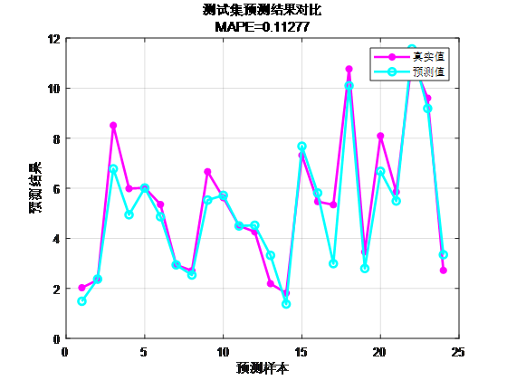
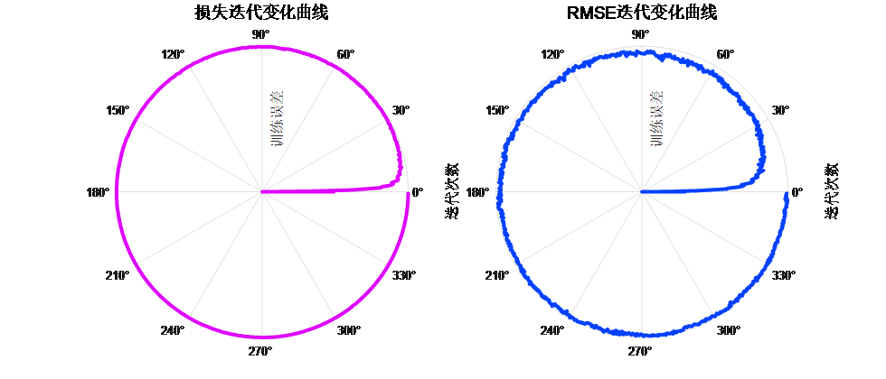
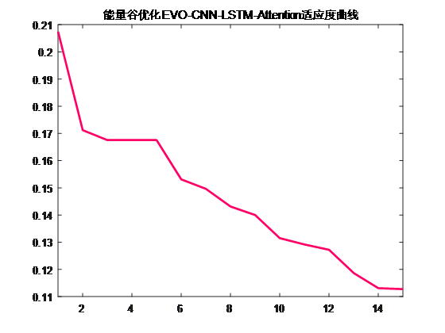

# New Algorithm: EVO-CNN-LSTM-Attention Leads by 24 Steps Multivariate Regression Prediction Algorithm, New Algorithm in 2023, directly write!

The program platform is suitable for MATLAB 2023 and above versions.

Code description: This algorithm combines the EVO energy valley optimization algorithm, convolutional neural network (CNN), and long short-term memory network (LSTM) with a multi-head attention mechanism for advanced 24-step multivariate time series regression prediction.

The Energy Valley Optimizer (EVO) is a novel metaheuristic algorithm introduced in 2023. The inspiration behind the EVO algorithm comes from the behavior of particles in the universe, particularly their stability and decay processes. Most particles are unstable and tend to release energy through disintegration or decay, while a few particles can remain stable indefinitely. The algorithm was proposed very recently and has not yet been applied in literature.

We utilized this newly developed algorithm to optimize the hyperparameters in our CNN-LSTM-Attention time-series and spatial feature combination-fusion attention mechanism regression prediction program code, forming the KOA-CNN-LSTM-Attention multivariate regression prediction model.

Functions:
1. Multivariate feature input with single sequence variable output, inputting the features of the previous day to predict the next day's data, achieving 24-step predictive forecasting.
2. Optimizing three key parameters using the Kepler optimization algorithm: learning rate, convolution kernel size, and number of neurons, with the minimum MAPES as the objective function.
3. Providing loss, RMSE iterative polar coordinate graph; network feature visualization graph; test comparison graph; fitness curve.
4. Providing calculation results such as MAPES, RMSE, MAE, etc.

Applicable fields:
Wind speed prediction, photovoltaic power prediction, power generation power prediction, carbon price prediction, and other applications.

Data format: One day's 18 meteorological features, sampling time is 24 hours, output is the power output of the next day's 24 hours, that is, 18×24 input, 1×24 output, there are 75 such samples.

Prediction value vs actual value comparison
\n     \n    Polar coordinates form of the training error curve (error decreases from inside to outside approaching zero); fitness curve (error gradually decreases)  
\n     \n  
EVO-CNN-LSTM-Attention fitness curve  
\n     \n

## Images

<!-- PAYMENT_BLOCK -->

## Get this dataset

- Payment link (Stripe): [Buy now](https://buy.stripe.com/3cs8yP7sY87d0vu9AB)
- Payment QR code: 

<!-- /PAYMENT_BLOCK -->
